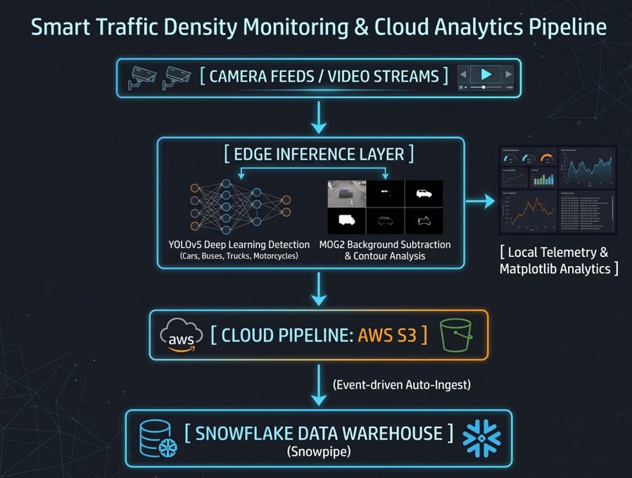

# Real-Time Smart Traffic Density Monitoring & Cloud Analytics Pipeline

An intelligent edge-to-cloud transportation monitoring system deployed on a **Raspberry Pi 5** edge node. The system performs multi-threaded camera acquisition, executes dual computer vision detection models at the edge, logs traffic telemetry locally, pushes structured JSON payloads to Amazon Web Services (AWS) S3, and triggers automated warehouse ingestion into Snowflake via Snowpipe.

---

## 📌 System Architecture

<p align="center">
  
</p>

1. **Edge Node (Raspberry Pi 5)**:
   - **Hardware**: Raspberry Pi 5 (Quad-core ARM Cortex-A76 @ 2.4GHz) managing USB 3.0/CSI video feeds and edge inferencing.
   - **Multi-Camera Ingestion**: Non-blocking, threaded frame acquisition (`camera_handler.py`) balancing input throughput across lanes.
2. **Dual-Model Edge Inference**:
   - **YOLOv5 Deep Learning**: Real-time vehicle detection and classification (`car`, `bus`, `truck`, `motorcycle`) using PyTorch on ARM64 (`yolo_detector.py`, `main.py`).
   - **OpenCV MOG2 Background Subtraction**: Fast morphological motion tracking with shadow suppression tailored for embedded CPU efficiency (`main_control.py`).
3. **Local Telemetry & Density Profiling**:
   - Time-series logging of vehicle density at configurable cycle intervals (`LOCAL_CSV_PATH.txt`).
   - Automated 4-quadrant traffic analytics dashboard (moving average, density histogram, volume trends) via Matplotlib.
4. **Cloud Staging (AWS S3)**:
   - Authenticated edge-to-cloud payload dispatch via `boto3` logging lane IDs, timestamps, and density counts.
5. **Continuous Data Warehousing (Snowflake & Snowpipe)**:
   - Serverless auto-ingest pipe staging raw JSON variant payloads directly from S3 into analytical data tables (`snowflake_interface.txt`).

---

## 🎥 Demo Video

Watch the complete demonstration of vehicle detection, density tracking, and cloud telemetry dispatch:

> Direct link in repository: [main_project_recording.mp4](video/main_project_recording.mp4)

*(Tip: You can drag and drop `video/main_project_recording.mp4` into the GitHub web README editor to embed an interactive, in-browser media player).*

---

## 📂 Project Structure

```text
├── codes/
│   ├── camera_handler.py       # Threaded multi-camera capture management
│   ├── LOCAL_CSV_PATH.txt      # Sample generated vehicle density telemetry log
│   ├── main_control.py         # Lane detection controller, MOG2 engine & S3 uploader
│   ├── main.py                 # Standalone YOLOv5 video inference & visualizer
│   ├── snowflake_interface.txt # Snowflake DDL, Storage Integration & Snowpipe setup
│   └── yolo_detector.py        # YOLOv5 deep learning detection wrapper
├── papers/                     # Reference papers and research background
├── video/
│   ├── architecture.png        # System architecture diagram
│   ├── main_project_recording.mp4 # Video demonstration of live monitoring
│   └── Recording 2025-10-01.mp4   # Raw test footage
├── .gitignore                  # Credential and artifact exclusion rules
├── requirements.txt            # Python dependencies manifest
└── README.md                   # Project documentation